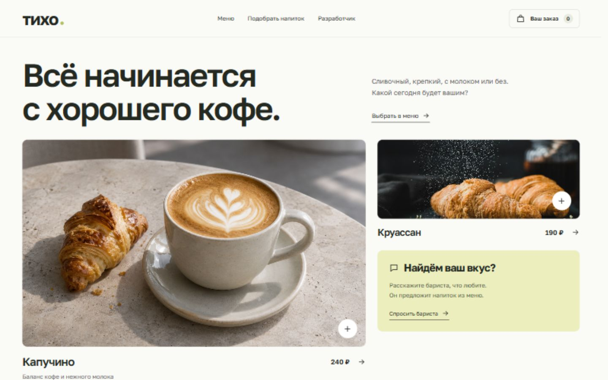

# тихо — кофейня

Интерактивный концепт для портфолио [Fle3n](https://github.com/Fle3n). Меню с выбором объёма и молока, корзина с демочеком и бариста, который подбирает напитки по вкусу и бюджету.



[Мобильная версия](previews/mobile.jpg) · [Связаться в Telegram: @fle3n](https://t.me/fle3n)

## Запуск

Требуется Node.js 20 или новее. Зависимостей для установки нет.

```sh
node server.mjs
```

Откройте [http://localhost:1051](http://localhost:1051). Переменная окружения `PORT` задаёт другой порт, если стандартный занят. `HOST=0.0.0.0` разрешает подключения с других устройств; по умолчанию доступ только с этого компьютера.

`public/` можно развернуть на статическом хостинге. В этой папке находится весь сайт; сервер нужен только для раздачи файлов.

## Возможности и ограничения

Меню вымышленное. Реальные заказы и оплата не выполняются. Корзина хранится в браузере. Помощник отвечает по локальным правилам; внешняя языковая модель не подключена.

## Проверка

```sh
node --test tests/logic.test.mjs
```

## Ресурсы

Golos Text и Prata распространяются по SIL Open Font License; тексты лицензий находятся в `public/assets/`.

Главное фото создано с помощью ImageGen. [Фото выпечки](https://images.unsplash.com/photo-1555507036-ab1f4038808a) — [Unsplash](https://unsplash.com/license).
